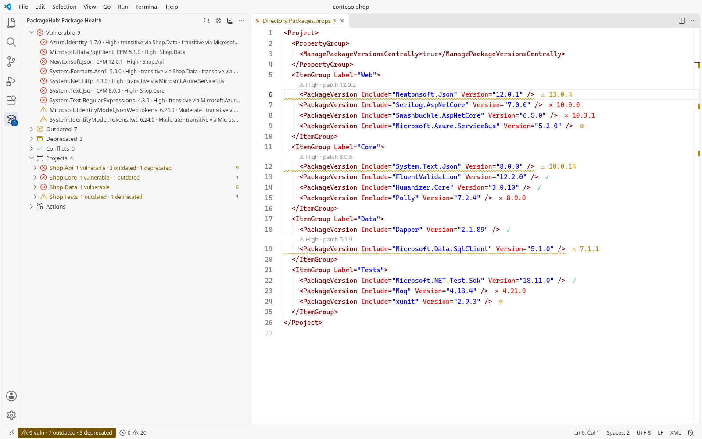
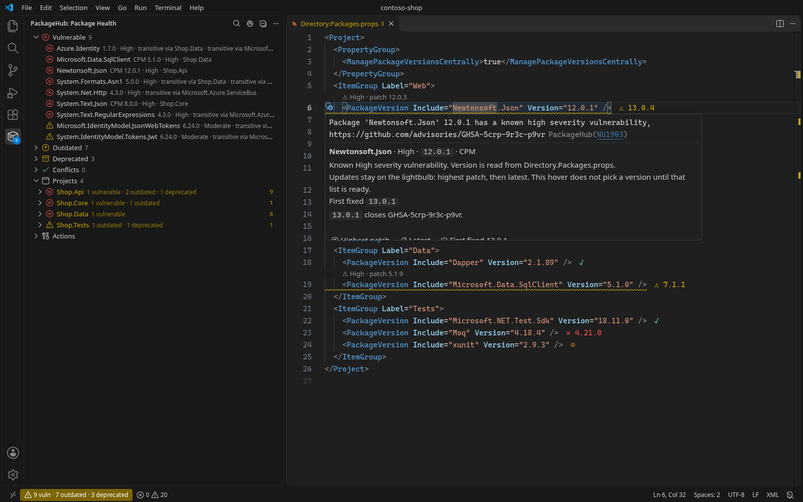
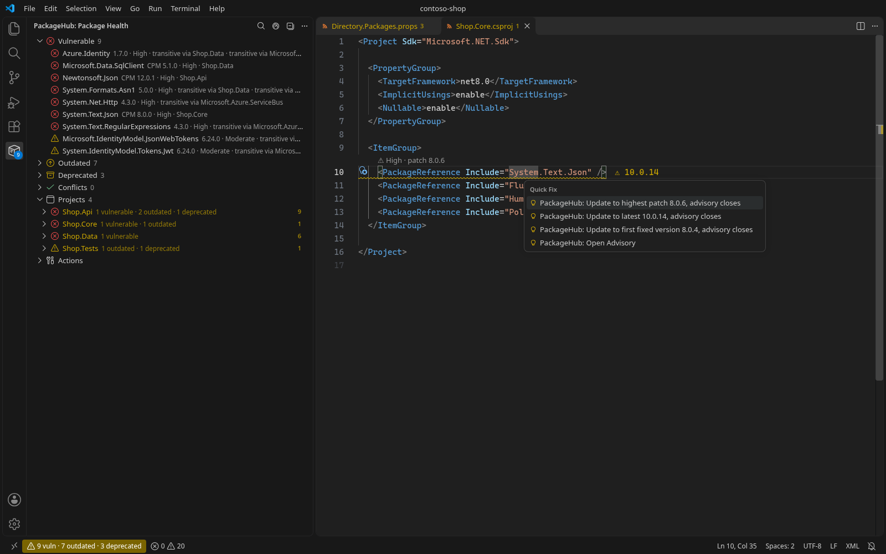
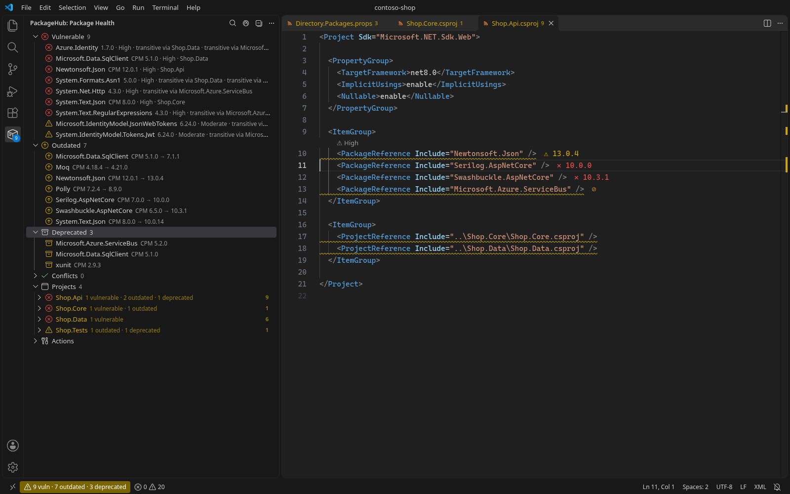
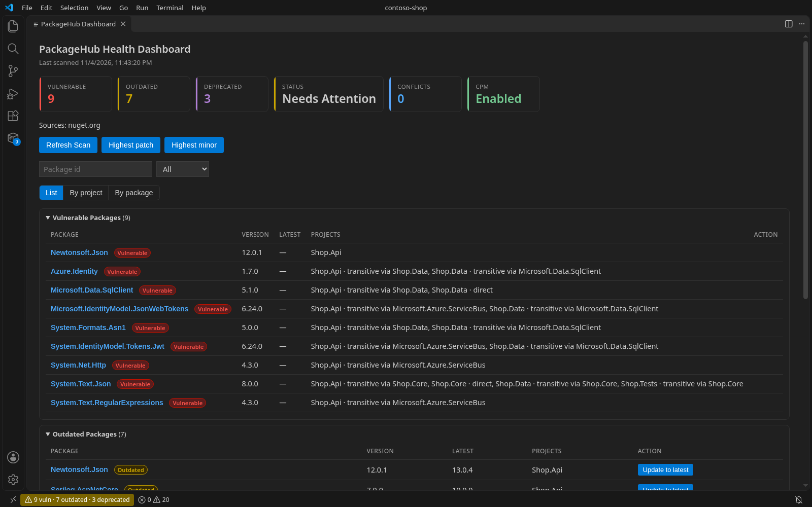
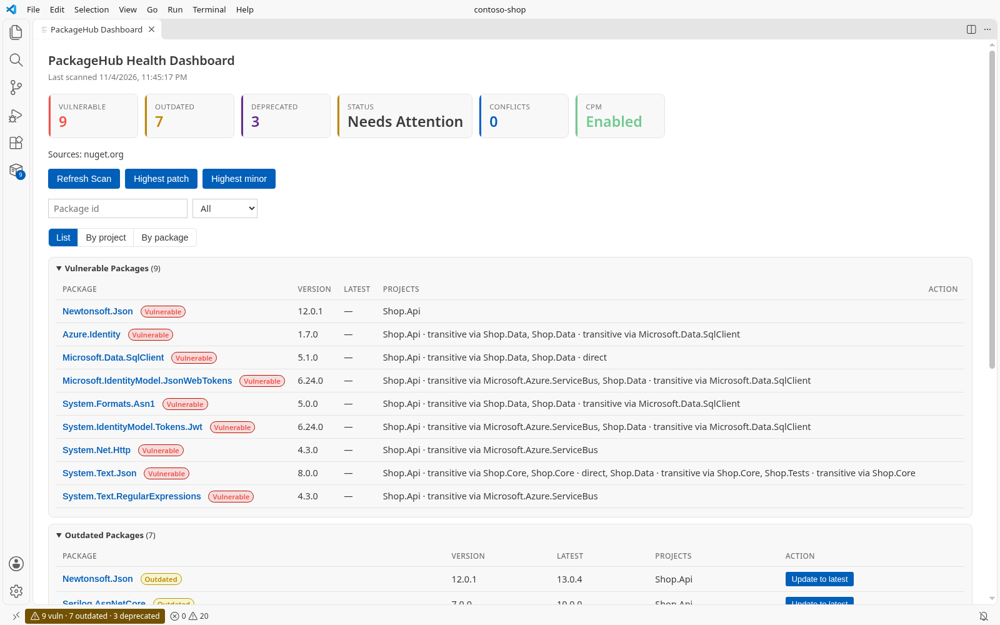
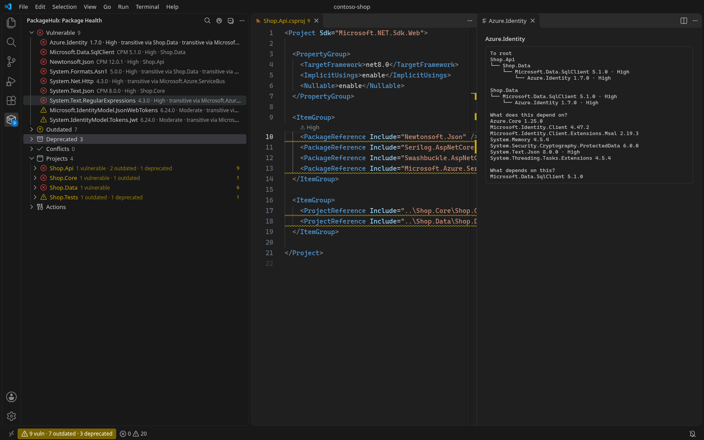
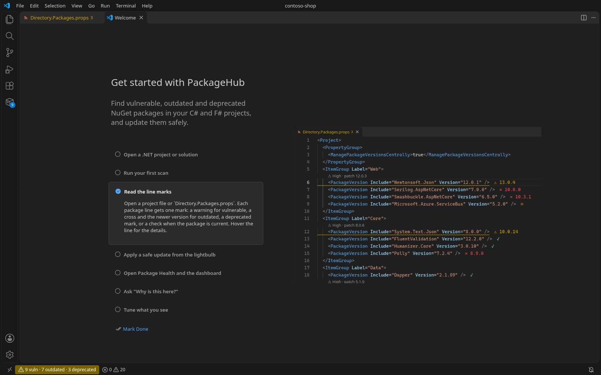
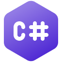

  

<h1 align="center">PackageHub</h1>

  <b>Your NuGet packages, checked on every line.</b> 
  See which packages in your C# and F# projects are vulnerable, outdated or deprecated, and apply the safe update in a few clicks.

  
  
  

## Why PackageHub

- **The answer is on the line.** After a scan, every package line in a `.csproj`, `.fsproj` or `Directory.Packages.props` shows one mark: vulnerable, outdated, deprecated or current. No more hunting through yellow warnings.
- **The safe update comes first.** The first suggestion is the highest patch in the same major version. A newer major is a separate choice you make on purpose.
- **Nothing changes behind your back.** Project files are written only after you choose **Yes, Update** or **Yes, Remove**.
- **Built for real solutions.** It reads `.sln` files, C# and F# projects, Central Package Management and transitive packages, and tells you which project brought a package in.
- **Private.** No account, no sign-in, and no usage data is collected or sent.

## Features

### Line marks on every package

The mark appears at the end of the package line after a scan.

| Mark | Meaning |
| --- | --- |
| Warning | The package is vulnerable. The newer version is written next to it when one exists. |
| Cross | The package is outdated. The version next to the cross is the latest version. |
| Deprecated | The package is deprecated. A newer version is shown when one exists. |
| Check | The scan read that project and the package is not vulnerable, outdated or deprecated. |

A check is drawn only when the installed, vulnerable, outdated and deprecated lists all include that project, so a project the scan could not read stays unmarked. The NU1901–NU1904 underline and the text above the line stay too: the mark does not replace them. The mark is not clickable, and moving the cursor over it does not run `dotnet`.

### A hover that explains the warning

Hover a package line to see the version, the severity, whether the advisory is still open, and the first version that closes it. The buttons run the same actions as the lightbulb. Opening the hover does not run `dotnet`.

### Safe updates from the lightbulb

Put the cursor on a vulnerable package and press **Ctrl+.** (**Cmd+.** on macOS).

1. **Update to highest patch** is first. It stays in the same major.
2. **Update to latest** comes next when a newer version exists.
3. **Update to first fixed version** appears when the advisory names one. It is not the default.
4. **Open Advisory** opens the advisory page when a link exists.

Each choice says whether the advisory closes or stays open. Confirm with **Yes, Update** and PackageHub updates the package, restores and scans again. The line above a vulnerable package (CodeLens) offers the highest patch in one click too.

### Package Health view

The **PackageHub** icon on the Activity Bar opens your packages, grouped into **Vulnerable**, **Outdated**, **Deprecated**, **Conflicts** and **Projects**. Each package shows its version, severity and the projects that use it, including `transitive via …`. Click a package to open its line. Right-click for Update, Show Package Info, Open on NuGet, Ignore, Dependencies, Why is this here? and Remove.

The status bar counts vulnerable, outdated and deprecated packages. Click it to open the dashboard.

### Health Dashboard

`PackageHub: Show Health Dashboard` shows how many packages need attention, the NuGet sources in use, and whether Central Package Management is on.

- **Highest patch** and **Highest minor** update every package within its major version.
- **Update to latest** on a row updates only that package.
- Filter by package id or severity, and switch between **List**, **By project** and **By package**.
- Version conflicts across projects get an **Align** button.

### Why is this here?

Not sure where a transitive package comes from? Choose **Why is this here?** from the hover, the Package Health view or the right-click menu on a package line. A window shows the path from each project to the package, what the package depends on, and what depends on it. The `dotnet nuget why` output is written to the Output panel. This needs the .NET SDK 8.0.400 or newer.

### Get started in a minute

Run **PackageHub: Get Started** for a short walkthrough: open a project, run the first scan, read the marks, apply a safe update, open the dashboard, ask why a package is there, and tune the settings.

### Hide or remove

- **Ignore** hides a package from PackageHub lists only. The build warning stays. **Unignore** brings it back.
- **Remove** takes the package out of the project after you confirm. You do not delete the line by hand.

### Share a report

`PackageHub: Copy Health Report` and `PackageHub: Copy Vulnerability Report` copy a Markdown summary to the clipboard, ready for a pull request or a ticket.

## Quick start

1. Install PackageHub and make sure `dotnet` is on your PATH.
2. Open a folder that contains a `.csproj`, `.fsproj`, `.sln` or `Directory.Packages.props` file. PackageHub starts on its own.
3. Wait for the startup scan, or run `PackageHub: Scan Workspace`. Saving a `.csproj`, `.fsproj` or `.props` file scans again.
4. Open a project file and read the marks. Hover a yellow line for the details.
5. Press **Ctrl+.** on a vulnerable package and pick **Update to highest patch**. Confirm with **Yes, Update**.

## Languages and files

  
  &nbsp;&nbsp;<strong>C#</strong>
  &nbsp;&nbsp;&nbsp;&nbsp;&nbsp;
  
  &nbsp;&nbsp;<strong>F#</strong>

- C# project files (`.csproj`)
- F# project files (`.fsproj`)
- Visual Studio solutions (`.sln`). `.slnx` files are skipped.
- Central package versions in `Directory.Packages.props`
- `GlobalPackageReference`, when the package and its version are on the same line

When a solution cannot be loaded in one pass, PackageHub scans its projects one by one. A project that cannot load (for example an old web project that cannot import `Microsoft.WebApplication.targets`) is named in the Output panel and skipped, and the rest of the solution stays in the results.

## Central Package Management

PackageHub reads the versions in `Directory.Packages.props`. The marks, the hover and the lightbulb work on the `PackageVersion` lines there, and on the `PackageReference` lines in your projects that have no version of their own.

When you update a package, the new version is written to `Directory.Packages.props`. You do not edit the project files by hand. The dashboard shows **CPM Enabled** when the workspace uses it.

## Commands

| Command | What it does |
| --- | --- |
| `PackageHub: Get Started` | Opens the walkthrough |
| `PackageHub: Scan Workspace` | Scans your packages again |
| `PackageHub: Show Health Dashboard` | Opens the summary and the bulk updates |
| `PackageHub: Why is this here?` | Shows how the package entered the project |
| `PackageHub: Update All to Highest Patch` | Applies the same-major patch across packages |
| `PackageHub: Update All to Highest Minor` | Applies the same-major minor update across packages |
| `PackageHub: Update to Highest Patch` / `Update to Latest` | Updates the package on the current line |
| `PackageHub: Open Advisory` | Opens the advisory for the package on the current line |
| `PackageHub: Ignore Package` / `Unignore Package` | Hides a package from the lists, or shows it again |
| `PackageHub: Remove Package` | Removes the package from the project after you confirm |
| `PackageHub: Restore All` | Runs `dotnet restore` for the solutions and projects in the workspace |
| `PackageHub: Copy Health Report` | Copies the health summary to the clipboard |
| `PackageHub: Copy Vulnerability Report` | Copies the vulnerability list to the clipboard |

## Settings

| Setting | Default | What it does |
| --- | --- | --- |
| `packageHub.scanOnStartup` | `true` | Scans your packages when the folder opens |
| `packageHub.includePrerelease` | `false` | Adds prereleases to the next outdated list. The vulnerability scan stays the same |
| `packageHub.minimumSeverity` | `low` | Lowest severity PackageHub lists: `low`, `moderate`, `high` or `critical`. It does not change `NuGetAuditLevel` in the project |
| `packageHub.minimumReleaseAge` | `0` | How many days old a latest version must be before it is preferred. `0` is off. The highest-patch suggestion ignores this |
| `packageHub.dashboardViewMode` | `list` | Dashboard layout: `list`, `byProject` or `byPackage` |
| `packageHub.ignoredPackages` | `[]` | Package ids hidden from the lists |

## Requirements

- VS Code 1.125.0 or newer
- `dotnet` on your PATH
- .NET SDK 8.0.400 or newer for **Why is this here?**

## Privacy

- **No usage data.** PackageHub does not collect or send telemetry, and there is no account or sign-in.
- **Your code stays on your machine.** Scanning, updating and the path lookup run the `dotnet` CLI locally. `dotnet` reads your NuGet sources to find vulnerabilities and newer versions, as it does on the command line.
- **Public package data only.** PackageHub reads public data from nuget.org (advisory ranges and, when `packageHub.minimumReleaseAge` is on, release dates). It does not send your project files.
- **Credentials stay where they are.** From `NuGet.config`, PackageHub reads only the source names it shows on the dashboard. It does not read or store credentials.

## FAQ

**Nothing shows on my package lines.** Run `PackageHub: Scan Workspace` and check the **PackageHub** channel in the Output panel. A project the scan could not read stays unmarked on purpose.

**Why is the first suggestion not the latest version?** A new major version can break your build. The highest patch in the same major is the safe default. **Update to latest** is right below it when you want it.

**Does Ignore hide the build warning?** No. Ignore only hides the package from PackageHub lists. The NU190x warning from `dotnet` stays.

**Does it work with F#?** Yes. `.fsproj` files get the same marks, warnings and actions as C# projects.

**Does it support `.slnx`?** Not yet. `.slnx` files are skipped and logged in the Output panel.

## Feedback

Questions and ideas are welcome in the Q&A section of the [Marketplace page](https://marketplace.visualstudio.com/items?itemName=onurkarakus.package-hub&ssr=false#qna). Release notes are in [CHANGELOG.md](CHANGELOG.md).

## License

MIT
