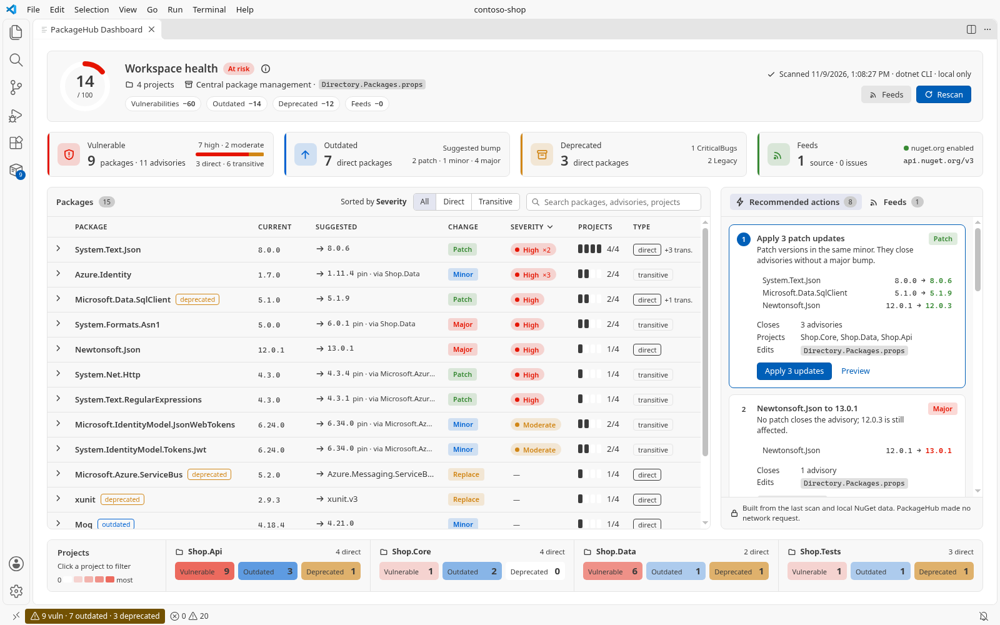
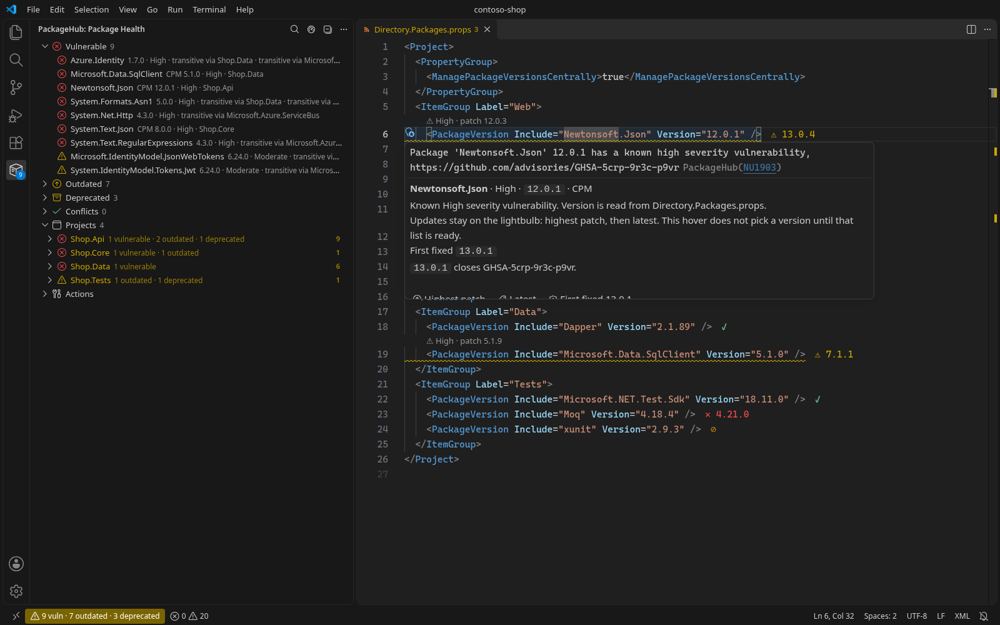
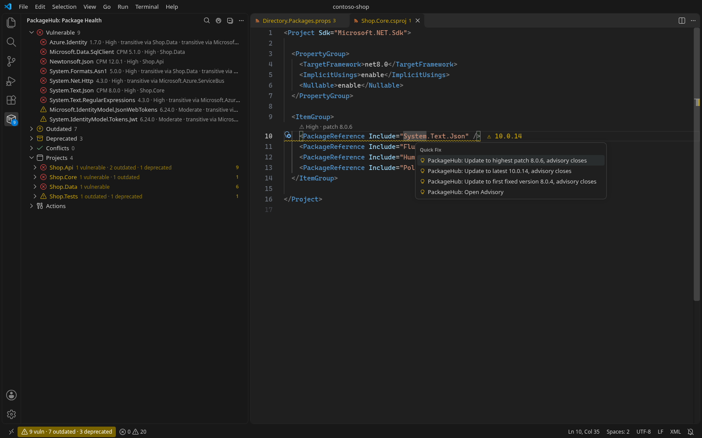
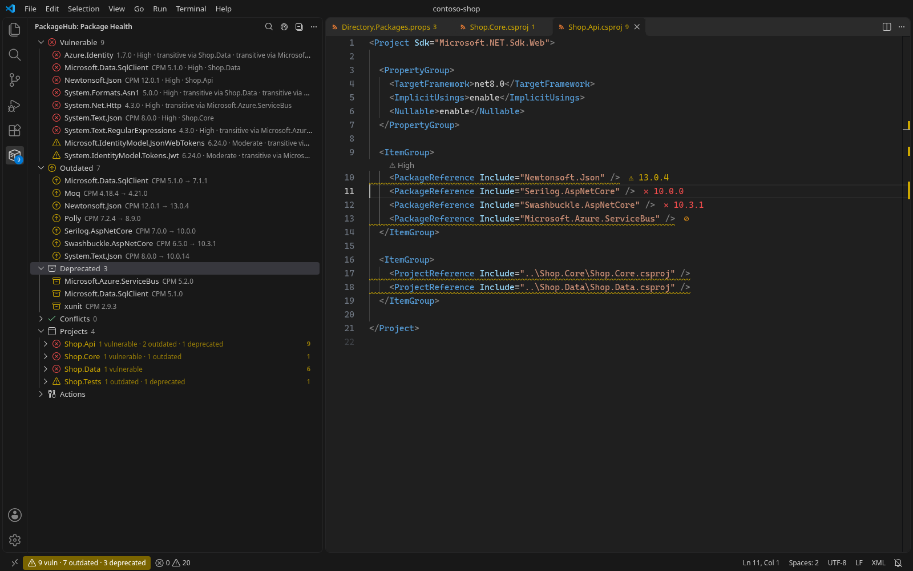
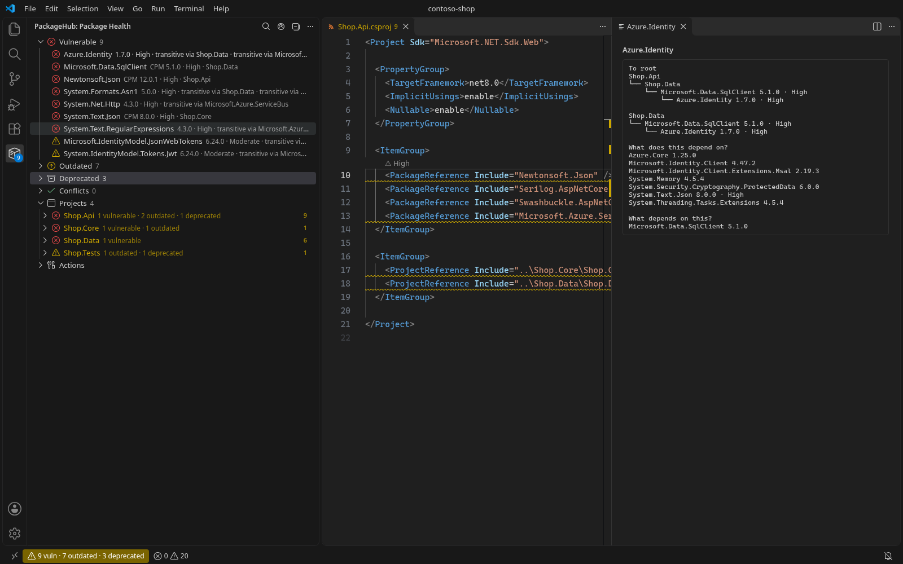
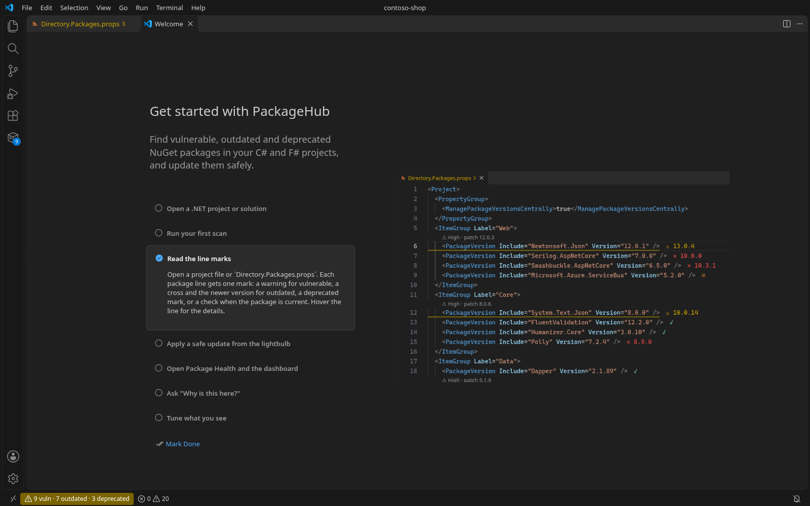
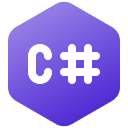

  

<h1 align="center">PackageHub</h1>

  <b>Your NuGet packages, checked on every line.</b> 
  See which packages in your C#, F# and Visual Basic projects are vulnerable, outdated or deprecated, add new ones, and apply the safe update in a few clicks.

  
  
  
  

## New in 0.3

- **Add a package** from the command palette, the Package Health view or the new **Add package** tab in the dashboard. PackageHub searches the local NuGet cache as you type, with no network request. When you ask for it, `dotnet package search` looks in the package sources from your NuGet.config. Pick the projects and the version, read the summary, and confirm. `dotnet add package` writes the reference, so Central Package Management works as usual.
- **Align versions** when projects drift apart on one package. One click brings every direct reference to the highest version already in use inside the same major version. Versions are never downgraded and never cross a major version, and a project that sets a different version per target framework keeps it.
- **What's in this update** in every confirmation: the license, the release notes and the dependency changes, read from the `.nuspec` in the local NuGet cache. With `packageHub.onlineLookups` on, a missing `.nuspec` is read from nuget.org.
- **`.slnx` solutions** are scanned, restored and watched like `.sln` files.
- **Visual Basic projects** (`.vbproj`) get the same marks, hover, lightbulb and updates.
- **Remove unused central versions**: find the `PackageVersion` entries in `Directory.Packages.props` that no project uses, preview them and remove the ones you pick.
- **Ranges, floating versions and properties**: an update keeps a version range and stays inside it, a floating version such as `1.*` is restored instead of rewritten, and a `$(Property)` version is updated where the property is defined.
- **Rollback on failure**: when one step of a bulk update fails, every file it touched is put back as it was.
- **Clickable line marks**: hover a mark for **Update**, **Open Advisory** and **Why is this here?** links.
- **Badge options**: the view badge can count vulnerable, outdated and deprecated packages. See `packageHub.badge`.
- **Turkish**: commands, settings, the dashboard and the messages follow VS Code's display language. English stays the default.

## Highlights

- **Health Dashboard** with a 0–100 score, a searchable package table, recommended updates you can preview and apply, and a heatmap per project.
- **Line marks** in `.csproj`, `.fsproj`, `.vbproj` and `Directory.Packages.props`: vulnerable, outdated, deprecated or current, at a glance. Hover a mark for one-click actions.
- **Safe updates first**: the highest patch in the same major is always the first suggestion. Nothing is written until you confirm a summary of the change.
- **Add packages** from the local NuGet cache or your package sources, with a project and version picker and the same confirmation.
- **Align drifted versions** inside one major version with one click.
- **Why is this here?** shows which project and package bring in a transitive dependency.
- **Central Package Management**, `VersionOverride`, `GlobalPackageReference`, `.sln` and `.slnx` solutions, C#, F# and Visual Basic.
- **Local-first**: no account, no telemetry, and no network request of its own by default.

## Quick start

1. Install PackageHub and make sure `dotnet` is on your PATH.
2. Open a folder that contains a `.csproj`, `.fsproj`, `.vbproj`, `.sln`, `.slnx` or `Directory.Packages.props` file. PackageHub starts on its own.
3. Wait for the startup scan, or run `PackageHub: Scan Workspace`. Saving a project or `.props` file scans again.
4. Open a project file and read the marks. Hover a yellow line for the details.
5. Press **Ctrl+.** on a vulnerable package and pick **Update to highest patch**. Confirm with **Yes, Update**.

## Features

### Health Dashboard

`PackageHub: Show Health Dashboard` gives the whole workspace in one place.

- **Health score** from 0 to 100. Vulnerable packages lower it by severity (critical 15, high 8, moderate 4, low 1, at most 60). Each outdated direct package takes 2 (at most 20), each deprecated one 4 (at most 12), and each failing feed 4 (at most 8). Hover the score to see the breakdown.
- **Packages that need attention**: search, filter by vulnerable, outdated, deprecated, direct or transitive, and sort by any column. Expand a row for its advisories, the projects that use it, the path that brings a transitive package in, and the version that closes the advisories.
- **Recommended actions**: the highest patch for every direct package, single updates where a patch is not enough, pins for transitive packages, and replacements for deprecated ones. Each shows the advisories it closes, the projects and files it edits, and the estimated score after it when the score goes up. **Preview** shows the update summary; **Apply** runs the same update as the rest of PackageHub, with the same confirmation.
- **Projects** shows a heatmap of vulnerable, outdated and deprecated packages per project. Click a project to filter the table.
- **Feeds** shows the same source status as the Feeds group.

Everything on the dashboard comes from the last scan and the local advisory data. Opening it runs no `dotnet` command and makes no network request. It follows your color theme, including high contrast.

### Line marks on every package

The mark appears at the end of the package line after a scan.

| Mark | Meaning |
| --- | --- |
| Warning | The package is vulnerable. The newer version is written next to it when one exists. |
| Cross | The package is outdated. The version next to the cross is the latest version. |
| Deprecated | The package is deprecated. A newer version is shown when one exists. |
| Check | The scan read that project and the package is not vulnerable, outdated or deprecated. |

A check is drawn only when the installed, vulnerable, outdated and deprecated lists all include that project, so a project the scan could not read stays unmarked. The NU1901–NU1904 underline and the text above the line stay too: the mark does not replace them. The mark is not clickable, and moving the cursor over it does not run `dotnet`.

### A hover that explains the warning

Hover a package line to see the version, the severity, whether the advisory is still open, and the first version that closes it. The buttons run the same actions as the lightbulb. Opening the hover does not run `dotnet`.

### Safe updates from the lightbulb

Put the cursor on a vulnerable package and press **Ctrl+.** (**Cmd+.** on macOS).

1. **Update to highest patch** is first. It stays in the same major.
2. **Update to latest** comes next when a newer version exists.
3. **Update to first fixed version** appears when the advisory names one. It is not the default.
4. **Open Advisory** opens the advisory page when a link exists.

Each choice says whether the advisory closes or stays open. Before anything is written, a summary shows the change from and to (patch, minor or major), the advisories it closes or leaves open, whether the package is direct or transitive, the projects it touches, whether `Directory.Packages.props` is edited, and prerelease or release-age warnings. It is built from the last scan and local files only. Pinning a transitive package asks for its own confirmation. Confirm with **Yes, Update** and PackageHub updates the package, restores and scans again. The line above a vulnerable package (CodeLens) offers the highest patch in one click too.

### Package Health view

The **PackageHub** icon on the Activity Bar opens your packages, grouped into **Vulnerable**, **Outdated**, **Deprecated**, **Conflicts**, **Projects** and **Feeds**. Each package shows its version, severity and the projects that use it, including `transitive via …`. Click a package to open its line. Right-click for Update, Show Package Info, Open on NuGet, Ignore, Dependencies, Why is this here? and Remove.

**Feeds** lists the NuGet sources `dotnet` uses, whether each is enabled, which ones failed in the last scan or restore (NU1301, NU1302, NU1801, NU1900, NU1905), and hints for credential providers. It reads only what `dotnet` reported; no feed is contacted to check it.

The status bar counts vulnerable, outdated and deprecated packages, and says when a project could not be checked. In a folder without .NET projects it shows a plain **PackageHub**. Click it to open the dashboard.

### Why is this here?

Not sure where a transitive package comes from? Choose **Why is this here?** from the hover, the Package Health view or the right-click menu on a package line. A window shows the path from each project to the package, what the package depends on, and what depends on it. The `dotnet nuget why` output is written to the Output panel. This needs the .NET SDK 8.0.400 or newer.

### Get started in a minute

Run **PackageHub: Get Started** for a short walkthrough: open a project, run the first scan, read the marks, apply a safe update, open the dashboard, ask why a package is there, and tune the settings.

### Add a package

Run `PackageHub: Add Package`, click **+** in the Package Health view, or open the **Add package** tab in the dashboard.

1. Type part of a package name. Packages already in your local NuGet cache show up right away, offline.
2. Not there? Pick **Search package sources**. `dotnet package search` runs with the sources and credentials in your NuGet.config. PackageHub never reads or stores a credential.
3. Pick one or more projects, then the version. The newest stable version is preselected.
4. Read the summary (projects, Central Package Management, license, release notes, dependencies) and confirm with **Yes, Add**.

With Central Package Management, `dotnet add package` writes the version to `Directory.Packages.props` and a reference without a version to each project. If one project fails, every file is put back as it was.

### Align drifted versions

When the Package Health view shows a version conflict, click **Align Versions** on it, run `PackageHub: Align Versions`, or use the **Review & align** action in the dashboard. Each major version is aligned on its own, to the highest version already in use there. Only direct references move. Ranges, floating versions and per-target-framework versions are listed as kept.

### What's in this update

Every update, pin and add confirmation lists what changes in the package: the license (and whether it changed), the release notes and the dependencies that were added, dropped or changed. The data comes from the `.nuspec` in the local NuGet cache. If the package is not there yet, the summary says so; turn on `packageHub.onlineLookups` to read it from nuget.org.

### Clean up Central Package Management

`PackageHub: Remove Unused Central Versions` lists the `PackageVersion` entries that no project in the workspace references. Pick the ones to remove and confirm. If a project cannot be read, nothing is removed, because that project might use them.

### Version ranges, floating versions and properties

- `[1.0.0, 2.0.0)`: an update writes `[1.4.0, 2.0.0)`, so the upper bound stays. A version outside the range is refused.
- `1.*`: when the floating version already covers the target, PackageHub runs restore instead of rewriting it.
- `$(SerilogVersion)`: the property is updated where it is defined, for example in `Directory.Build.props`. A property set under a `Condition` is left for you to edit.

### Hide or remove

- **Ignore** hides a package from PackageHub lists only. The build warning stays. **Unignore** brings it back.
- **Remove** takes the package out of the project after you confirm. You do not delete the line by hand.

### Share a report

`PackageHub: Copy Health Report` and `PackageHub: Copy Vulnerability Report` copy a Markdown summary to the clipboard, ready for a pull request or a ticket.

## Languages and files

  
  &nbsp;&nbsp;<strong>C#</strong>
  &nbsp;&nbsp;&nbsp;&nbsp;&nbsp;
  
  &nbsp;&nbsp;<strong>F#</strong>
  &nbsp;&nbsp;&nbsp;&nbsp;&nbsp;
  <strong>Visual Basic</strong>

- C# project files (`.csproj`)
- F# project files (`.fsproj`)
- Visual Basic project files (`.vbproj`)
- Visual Studio solutions (`.sln`) and XML solutions (`.slnx`)
- Central package versions in `Directory.Packages.props`
- `GlobalPackageReference`, `VersionOverride`, and package elements that span several lines

When a solution cannot be loaded in one pass, PackageHub scans its projects one by one. A project that cannot load (for example an old web project that cannot import `Microsoft.WebApplication.targets`) is named in the Output panel and skipped, and the rest of the solution stays in the results.

## Central Package Management

PackageHub reads the versions in `Directory.Packages.props`. The marks, the hover and the lightbulb work on the `PackageVersion` lines there, and on the `PackageReference` lines in your projects that have no version of their own.

When you update a package, the new version is written to `Directory.Packages.props`. A `VersionOverride` is updated in the project that sets it, and a `GlobalPackageReference` in the file that declares it. You do not edit the project files by hand. The dashboard header shows **Central package management** and the file it reads when the workspace uses it.

## Commands

| Command | What it does |
| --- | --- |
| `PackageHub: Get Started` | Opens the walkthrough |
| `PackageHub: Scan Workspace` | Scans your packages again |
| `PackageHub: Show Health Dashboard` | Opens the summary and the bulk updates |
| `PackageHub: Add Package` | Searches for a package and adds it to the projects you pick |
| `PackageHub: Align Versions` | Brings one package to the same version across projects, inside each major version |
| `PackageHub: Remove Unused Central Versions` | Removes `PackageVersion` entries no project uses |
| `PackageHub: Why is this here?` | Shows how the package entered the project |
| `PackageHub: Dependencies` | Opens the dependency graph for the package on the current line |
| `PackageHub: Explain Selected Package` | Shows what the last scan found for the package on the current line |
| `PackageHub: Update All to Highest Patch` | Applies the same-major patch across packages |
| `PackageHub: Update All to Highest Minor` | Applies the same-major minor update across packages |
| `PackageHub: Update to Highest Patch` / `Update to Latest` | Updates the package on the current line |
| `PackageHub: Open Advisory` | Opens the advisory for the package on the current line |
| `PackageHub: Ignore Package` / `Unignore Package` | Hides a package from the lists, or shows it again |
| `PackageHub: Remove Package` | Removes the package from the project after you confirm |
| `PackageHub: Restore All` | Runs `dotnet restore` for the solutions and projects in the workspace |
| `PackageHub: Copy Health Report` | Copies the health summary to the clipboard |
| `PackageHub: Copy Vulnerability Report` | Copies the vulnerability list to the clipboard |

## Settings

| Setting | Default | What it does |
| --- | --- | --- |
| `packageHub.scanOnStartup` | `true` | Scans your packages when the folder opens |
| `packageHub.includePrerelease` | `false` | Adds prereleases to the next outdated list. The vulnerability scan stays the same |
| `packageHub.minimumSeverity` | `low` | Lowest severity PackageHub lists: `low`, `moderate`, `high` or `critical`. It does not change `NuGetAuditLevel` in the project |
| `packageHub.minimumReleaseAge` | `0` | How many days old a latest version must be before it is preferred. `0` is off. The highest-patch suggestion ignores this. Publish dates come from the local NuGet cache |
| `packageHub.ignoredPackages` | `[]` | Package ids hidden from the lists |
| `packageHub.onlineLookups` | `false` | Lets PackageHub ask nuget.org itself for advisory ranges, publish dates and package metadata that are not in the local cache |
| `packageHub.badge` | `vulnerable` | What the view badge counts: `vulnerable`, `vulnerableAndOutdated`, `all` (vulnerable, outdated and deprecated) or `off` |
| `packageHub.rollbackOnFailure` | `true` | Puts every file back when one step of a bulk update or add fails |
| `packageHub.timeouts.listSeconds` | `120` | Timeout for `dotnet list package` and other quick commands |
| `packageHub.timeouts.outdatedSeconds` | `300` | Timeout for the outdated and deprecated lists |
| `packageHub.timeouts.restoreSeconds` | `600` | Timeout for `dotnet restore` and `dotnet add package` |
| `packageHub.maxDotnetProcesses` | `4` | How many `dotnet` processes run at the same time |

## Requirements

- VS Code 1.74 or newer, or a compatible editor such as Cursor or VSCodium
- `dotnet` on your PATH
- .NET SDK 8.0.400 or newer for **Why is this here?**
- .NET SDK 8.0.200 or newer to search package sources from **Add Package** (the local cache search works with any SDK)

## Local-first

PackageHub works from what is already on your machine. With the default settings the extension itself makes no network request: no telemetry, no account, no calls to nuget.org of its own.

- **No usage data.** PackageHub does not collect or send telemetry, and there is no account or sign-in. It runs `dotnet` with `DOTNET_CLI_TELEMETRY_OPTOUT=1`.
- **Your code stays on your machine.** Package data comes from the `dotnet` CLI and from local files: your project files, `project.assets.json`, and the NuGet caches `dotnet` already wrote. `dotnet` itself reads the package sources in your NuGet.config to find vulnerabilities and newer versions, as it does on the command line.
- **Online lookups are opt-in.** Only when you turn on `packageHub.onlineLookups` does PackageHub contact `api.nuget.org` over HTTPS itself, for advisory version ranges, for the release dates `packageHub.minimumReleaseAge` needs, and for the `.nuspec` of a version that is not in the local cache. It never sends your project files. With it off, a missing release date is reported as unknown and the age gate is not applied.
- **Credentials stay where they are.** Feed health uses the source list from `dotnet nuget list source` and the messages `dotnet` printed. PackageHub does not read or store credentials, and it does not contact a feed to test it.
- **Package search is yours to start.** **Add Package** searches the local NuGet cache first. The package sources are searched only when you pick **Search package sources**, and then `dotnet package search` does it, with your NuGet.config.
- **Links open only when you click them.** NuGet and advisory pages open in your browser.

The only code path that can reach the network is the opt-in online lookup above. The dashboard, the hover, the lightbulb and the update summary are all built from the last scan and local files.

## FAQ and troubleshooting

**Nothing shows on my package lines.** Run `PackageHub: Scan Workspace` and check the **PackageHub** channel in the Output panel. A project the scan could not read stays unmarked on purpose.

**PackageHub does not start.** It starts when the folder has a `.csproj`, `.fsproj`, `.vbproj`, `.sln`, `.slnx` or `Directory.Packages.props` file, and only in a trusted workspace, because `dotnet` and MSBuild can run code from the project. Trust the folder and run `PackageHub: Scan Workspace`.

**`dotnet` was not found.** Make sure `dotnet --version` works in the terminal VS Code opens. On macOS, start VS Code from a terminal once if it does not see your PATH.

**The scan says the audit source returned no vulnerability data.** Your feeds may not provide vulnerability data, or the last restore ran with NuGetAudit off. Restore once with network access, or turn on `packageHub.onlineLookups`.

**A feed fails with NU1301.** Open **Feeds** in the Package Health view or the dashboard. It shows the failing source and a hint, for example a missing credential provider.

**The dashboard score did not change after an update.** The dashboard shows the last scan. PackageHub scans again after an update it applied; after a change you made by hand, run `PackageHub: Scan Workspace`.

**I still have `packageHub.dashboardViewMode` in my settings.** It was removed in 0.2.0 and is ignored. You can delete the line.

**Why is the first suggestion not the latest version?** A new major version can break your build. The highest patch in the same major is the safe default. **Update to latest** is right below it when you want it.

**Does Ignore hide the build warning?** No. Ignore only hides the package from PackageHub lists. The NU190x warning from `dotnet` stays.

**Does it work with F# and Visual Basic?** Yes. `.fsproj` and `.vbproj` files get the same marks, warnings and actions as C# projects.

**Does it support `.slnx`?** Yes, since 0.3.0. `.slnx` solutions are scanned, restored and watched like `.sln` files.

**Search package sources says the command is not recognized.** `dotnet package search` needs .NET SDK 8.0.200 or newer. The local cache search still works.

**Can I use PackageHub in Turkish?** Yes. Install the Turkish language pack for VS Code and pick Turkish with `Configure Display Language`. Commands, settings, the dashboard and the messages follow it.

## Feedback

Questions and ideas are welcome in the Q&A section of the [Marketplace page](https://marketplace.visualstudio.com/items?itemName=onurkarakus.package-hub&ssr=false#qna). Release notes are in the [changelog](https://github.com/onurkarakus/package-hub/blob/master/CHANGELOG.md). Bugs and feature requests go to [GitHub issues](https://github.com/onurkarakus/package-hub/issues).

## Contributing

Build and test instructions are in [CONTRIBUTING.md](https://github.com/onurkarakus/package-hub/blob/master/CONTRIBUTING.md).

## License

[MIT](https://github.com/onurkarakus/package-hub/blob/master/LICENSE)
